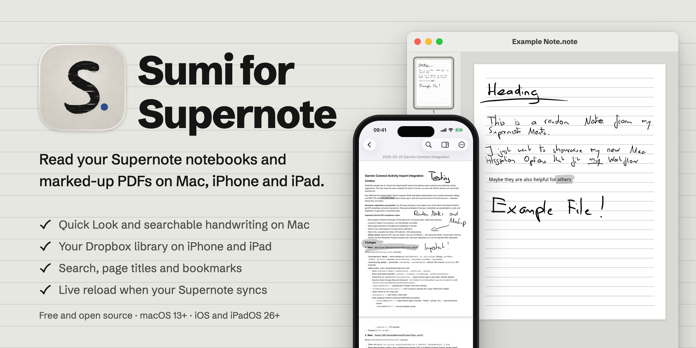
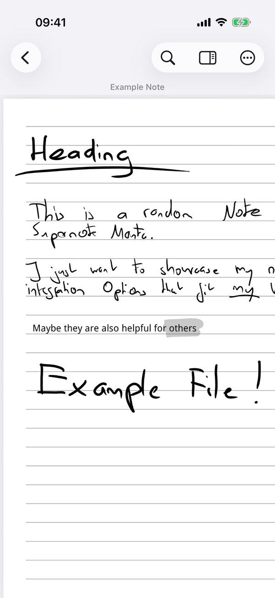
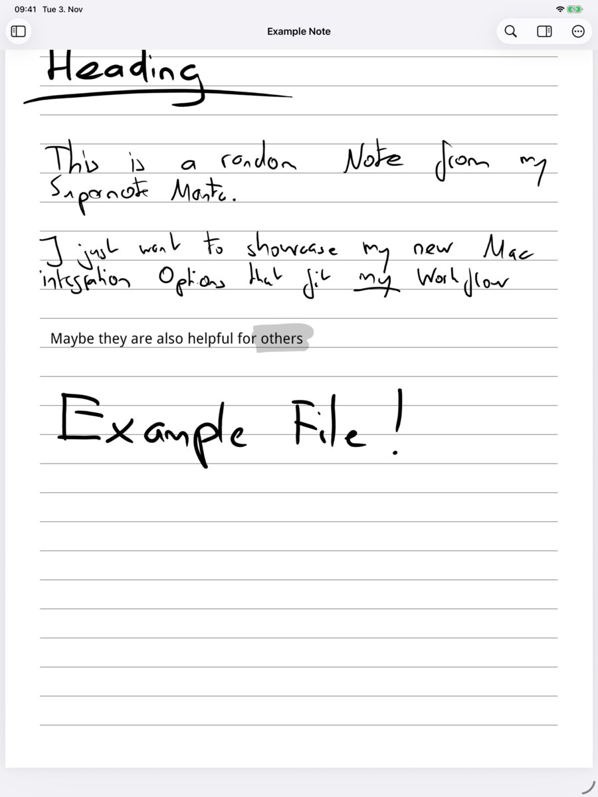

<p align="center">
  
</p>

<p align="center">
  <a href="https://github.com/schaefer-dev/supernote-viewer/releases/latest"></a>
  
  
  
  <a href="LICENSE"></a>
</p>

Your Supernote syncs `.note` notebooks and `.pdf.mark` annotations, but neither macOS nor iOS can open them. **Sumi for Supernote** fixes that on your Mac, iPhone and iPad. Handwriting is drawn as crisp vector ink from the notebook's own pen data and made searchable with on-device text recognition. No sign-up and no tracking: your notes stay on your devices and in your own Dropbox.

| | App | What it does |
|---|---|---|
| **Mac** | **Sumi for Supernote** | Opens notes in its own window, with thumbnails, live reload and a measuring tool, or turns them into PDFs and opens them in Apple's **Preview**, so you keep the tools you already know. |
| **iPhone & iPad** | **Sumi** | Reads the notebooks and annotated PDFs your Supernote syncs to Dropbox, with search, page titles, bookmarks and favorites. |

On the Mac, Sumi comes with Quick Look, and a setting decides whether a double-click opens your files in Sumi or in Preview.

> **Why not just use Supernote Partner?** Ratta's official app is a companion for managing files in Supernote Cloud. Sumi is built for *reading* your notes: it fits into Finder and Preview, makes all your handwriting searchable, works with Dropbox and needs no account. [See how they compare →](#sumi-vs-supernote-partner)

## Features

### On your Mac

#### Opens in Preview, with searchable handwriting

With **Open Supernote files in: Preview** (Settings, ⌘,), double-click a notebook and it opens in Apple's Preview. Handwriting is drawn as vector strokes from the notebook's own pen data, so it stays crisp at any zoom. Apple's on-device text recognition adds an invisible text layer (English and German), so you can search with ⌘F and select and copy your handwriting. Typed text boxes and marker highlights come through as well. Titles you mark on the Supernote become the PDF's table of contents (View → Table of Contents), so you can jump between sections.

<p align="center"></p>

#### Quick Look in Finder

Select a `.note` or `.pdf.mark` file and press Space for a full preview without opening any app.

#### Sumi for Supernote: its own window, with live reload

Marked-up PDFs show your handwriting on top of the original document. There's a thumbnails sidebar (⌥⌘2). When your Supernote syncs a change, the open window updates by itself, so you can keep a notebook open on your Mac while you write on the device.

<p align="center"></p>

#### Measure plans to scale

For floor plans and sketches: choose **Calibrate** and drag along a length you know (e.g. `2,23 m`), then choose **Measure** and drag. Hold ⇧ for straight lines; click a line and press ⌫ to delete it. **Export PDF…** saves the measurements as standard PDF annotations. Calibrations and measurements are saved per file. Measuring also works on plain PDFs (Open With → Sumi for Supernote, or the Finder Quick Action **Measure in Sumi for Supernote**).

### On iPhone and iPad

**Sumi** brings the same renderer to iPhone and iPad (iOS and iPadOS 26 or later).

- **Your Supernote library from Dropbox.** Connect Dropbox with read-only access, choose the folder your Supernote syncs to, and browse your notebooks and annotated PDFs. Sumi never changes, uploads or deletes anything.
- **Ready offline.** Turn on **Sync All When App Opens** and new and changed documents in your library folder are downloaded each time Sumi opens, so they're there when you're not online.
- **Search your handwriting.** Find words in handwritten notes, jump through matches, and open a page grid with the titles you marked on the Supernote.
- **Bookmarks and favorites.** Star whole documents or bookmark a page; bookmarks show the page's handwritten title. Home keeps favorites and recent documents one tap away.
- **Opens shared files too.** Open a `.note` or `.pdf.mark` from Files, Mail or any other app, and export any document as a PDF.

<p align="center">
  
  &nbsp;&nbsp;
  
</p>

## Sumi vs. Supernote Partner

[Supernote Partner](https://apps.apple.com/app/supernote-partner/id1494992020) is Ratta's official companion app for iPhone, iPad and Mac. It manages the files in your Supernote Cloud account. Sumi does one job, reading your notes, and puts its effort into doing it well.

| | **Sumi** | **Supernote Partner** |
|---|---|---|
| **Account** | None. No sign-up, no login. | Supernote account required |
| **Where your notes come from** | Dropbox (read-only), Finder, Files, Mail or any other app | Supernote Cloud |
| **On the Mac** | A native Mac app. Quick Look in Finder, and double-clicking opens your files in Sumi or Apple's Preview. | No Quick Look or Finder integration, and it doesn't look or feel like a Mac app |
| **Search your handwriting** | All of it, recognized on your device. ⌘F in Preview, search on iPhone and iPad. | Not for regular handwriting |
| **Handwriting quality** | Vector ink drawn from the pen data, crisp at any zoom | — |
| **Navigate long notebooks** | Titles you mark become a table of contents. Page titles, bookmarks and favorites. | — |
| **While you write** | The open window updates as soon as your Supernote syncs | — |
| **Floor plans and sketches** | Calibrate and measure to scale, then export the measurements as PDF annotations | — |
| **Your files** | Never changed, uploaded or deleted. Open source (MIT). | Syncs and edits files in Supernote Cloud |

**What Partner does that Sumi doesn't:** it renames, moves and deletes files in Supernote Cloud, sends files to your device, syncs to-dos and digests, and exports notes to text. Sumi only reads your files and never changes them, so you can use both apps side by side.

## Install on your Mac

1. Download the **.dmg** from the [latest release](https://github.com/schaefer-dev/supernote-viewer/releases/latest).
2. Open it and drag **Sumi for Supernote** to **Applications**. The app is signed, so it should open without any security warnings.
3. Open **Sumi for Supernote** once. This turns on the Quick Look extension.
4. Choose where double-clicked files open: **Sumi for Supernote → Settings… (⌘,) → Open Supernote files in**.
   - **Sumi for Supernote** if you want thumbnails, live reload or measuring.
   - **Preview** if you'd rather annotate, sign or print in Preview.

   PDFs opened with Sumi and the **Measure in Sumi for Supernote** Quick Action always use Sumi's own window.

Want to try it before syncing your own notes? Use the files in [`examples/`](examples/).

If Quick Look previews don't show up, check that **Supernote Quick Look** is turned on under System Settings → General → Login Items & Extensions → Quick Look.

### Upgrading from Supernote Preview Bridge

Up to version 1.4, Preview support was a separate app, **Supernote Preview Bridge**. It's now part of Sumi. Move the old Bridge app to the Trash, then choose **Preview** in Sumi's Settings. If Finder still opens files with something else, select a `.note` file → **Get Info** → **Open with** → **Sumi for Supernote** → **Change All…**, and do the same for a `.mark` file.

### How Preview copies work

In Preview mode, Sumi opens a generated PDF from `~/Library/Caches/dev.schaefer.SupernoteViewer/`. It's regenerated when the notebook changes. If you edited that copy in Preview and saved it, it's never overwritten; the next render goes to `Name 2.pdf`. To keep an annotated version, use File → Export or Duplicate.

## Compatibility and feedback

Tested with Supernote **Manta** files (format `SN_FILE_VER_20260016`, Chauvet 3.28.42). Other models (Nomad, A5 X, A6 X2) use the same format family and will probably work, but they're untested. If a file from your device doesn't render correctly, please [open an issue](https://github.com/schaefer-dev/supernote-viewer/issues) and, if you can, attach a sample file.

Handwriting recognition is only as good as Apple Vision is on quick handwriting, so expect some misread words in search and in the table of contents.

## Build from source

Requires Xcode and [XcodeGen](https://github.com/yonaskolb/XcodeGen).

```sh
brew install xcodegen
./install.sh
```

This builds Sumi for Supernote and installs it to `/Applications`, replacing a copy installed from the DMG (and removing an old Supernote Preview Bridge). The app is signed ad-hoc, which is fine on your own Mac. To sign with your Apple Development certificate instead, run `DEVELOPMENT_TEAM=<your team ID> ./install.sh`.

`./release.sh` builds the signed and notarized DMG for a GitHub release. The script prints the one-time setup it needs.

### iOS app releases

Copy `.env.example` to `.env` and fill it in. `.env` is gitignored. The App Store Connect API key (`.p8`) stays outside the repository.

- `scripts/ios-release.sh` runs the tests, archives with the commit count as build number, checks the archive (bundle ID, Dropbox key) and uploads it to App Store Connect for TestFlight. `--no-upload` only archives.
- `scripts/appstore-screenshots.sh` captures the App Store screenshots on the iPhone 6.9" and iPad 13" simulators (`ViewerIOSUITests/AppStoreScreenshotTests.swift`). `swift scripts/frame-screenshots.swift <dir>` adds the captions. Both write to `APPSTORE_DIR`, which lives outside this repository.

Privacy policy and support: <https://schaefer-dev.de/sumi/privacy/> and <https://schaefer-dev.de/sumi/support/>.

<details>
<summary><b>For developers: project layout and file format notes</b></summary>

### Layout

- `SupernoteKit/`: Swift package with the file parser, RLE decoder, layer compositor, stroke (`TOTALPATH`) parser, vector renderer, handwriting text layer and PDF renderer.
  - `swift test` runs the tests. Tests that use the files in `examples/` always run. Tests that need private sample files in `example_files/` are skipped when those files are missing.
  - `swift run -c release snrender <file> out.pdf [--png outdir] [--dpi n] [--bitmap] [--ocr] [--benchmark [n]]` renders a file from the command line. With `--ocr` it also prints the text layer and the table of contents. With `--benchmark` it renders the file n more times (default 5) after a warm-up and prints total and per-page timings. Use a release build for meaningful numbers.
- `QuickLookPreview/`: the Quick Look extension. It is data-based and returns a PDF built by `PDFRenderer`.
- `Shared/`: the render cache used by Sumi's windows and its Preview mode.
- `Viewer/`: Sumi for Supernote. Its PDFKit window has thumbnails, live reload and measuring; in Preview mode (`SettingsView.swift`) it hands rendered PDFs to Preview instead. It exports the `.note` and `.mark` file types.
- `ViewerIOS/`: Sumi for iPhone and iPad (SwiftUI). It reads documents from Dropbox with read-only access and renders them with SupernoteKit. `ViewerIOSUITests/` drives it with the files in `examples/`.
- `project.yml`: the XcodeGen spec. The `.xcodeproj` is generated from it.
- `Viewer/AppIcon.icon`, `ViewerIOS/AppIcon.icon`: the app icons, made for Icon Composer (layers, glass, light-only appearance). Xcode builds the macOS 13–15 images from them. The brush S and washi layers are PNGs rendered by `Artwork/render.sh`; `Artwork/sumi/` has the brand artwork.
- `Artwork/`: icon sources. `render.sh` regenerates the icon layers and the `.note`/`.mark` document icons (`Shared/*.icns`) from `artwork.py`. `release.sh` uses `app-icon.swift` for the DMG volume icon, and the README banner uses it too.
- `docs/hero/`: source of the README banner (`render.sh` regenerates it).

### Debugging

- Renderer changes: `snrender` always renders fresh and leaves the apps' cache alone, e.g. from `SupernoteKit/`: `swift run snrender "../examples/Example Titles.note" /tmp/out.pdf --ocr && open /tmp/out.pdf`.
- Preview from Xcode: in the SupernoteViewer scheme, Edit Scheme → Run → Arguments, tick the example path (or add your own `.note`/`.mark`) and press Run. Debug builds open it freshly rendered in Preview, with breakpoints working and nothing installed or deleted. Release builds ignore the argument.
- Outside Xcode, `touch file.note` makes Sumi render that file again.
- SupernoteKit is compiled with optimization in Debug builds too (`Package.swift`); unoptimized, large notebooks take minutes.

### Stroke data (`TOTALPATH`)

Each page's `TOTALPATH` block holds every stroke, including the device's own rendered outline polygons. Filling those outlines reproduces the device bitmap exactly. See `Strokes.swift` for the record layout.

- Erased strokes stay in the file, flagged −4.
- Surviving pieces of erased strokes are stored as outline-only fragments.
- Eraser strokes have color 255.

A per-layer coverage check falls back to the bitmap if the strokes don't account for the layer's ink.

### Titles

The footer lists each title as `TITLE_<page><y><x>` (older files: `TITLE_<page><y>`), pointing to a block with `TITLERECT`, `TITLELEVEL` and a bitmap of the title. The table of contents labels each title with the text layer words inside `TITLERECT`, so it needs no extra recognition pass. Without the text layer (Quick Look) there is no table of contents.

### Credits

Format notes come from [supernotelib](https://github.com/jya-dev/supernote-tool) and [GoSNare](https://github.com/alefaraci/GoSNare).

</details>

## License

[MIT](LICENSE). Not affiliated with Ratta or Supernote. Supernote and Supernote Partner are products of Ratta.
